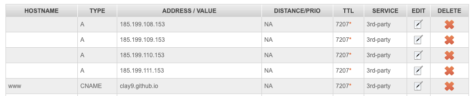

#+title: 静态网站生成器
#+hugo_custom_front_matter: :bookCollapseSection false

* 前言
  记录blog好处很多, 却也增加了使用者的难度, 比如要理解html,css等. 同时,外在的表现往往会导致重心偏移, 过多追求外在的东西, 忽略了记录blog的初衷.
  因此, 我们需要一个工具来帮助我们搭建blog. 这样, 我们就可以专注于文章知识本身, 不用关系其他的技术细节.

  当下(2026/11) 比较流行的工具是静态网站生成器. 而Hugo 是静态网站生成器中, 比较热门的.
  Hugo 可以将markdown 语言转为html, 并且有丰富的主题外观, 使我们可以专注文章本身.
-----

* hugo 优势
  静态网站生成器功能都比较接近, 选择Hugo 的原因只要有:
  1. 有丰富的主题
  2. 与Github action 结合比较好, 无须在本地搭建Hugo 运行环境

    -----

* hugo 使用
  Hugo 的配置非常简单, 可以参考[[https://github.com/clay9/clay9.github.io/blob/master/config.toml][config.toml]]
  Github action的配置, 可以参考[[https://github.com/clay9/clay9.github.io/blob/master/.github/workflows/gh-pages.yml][gh-pages.yml]]

  Hugo 执行流程是把content目录下的markdown文件 转换为静态的html文件
  所以我们可以在Hugo 执行之前, 进行自己的操作. 比如把org 文件生成为markdown 文件.
  同样的, 我们也可以在Hugo 执行之后, 把自己的html文件放到content目录

  #+attr_shortcode: info
  #+begin_hint
  大部分执行动作都由Github action 处理了, 我们只需要维护自己的blog 文件, 并Git push 即可.
  Blog 站点的更新流程由Github action 自动完成
  #+end_hint
  -----
* hugo 概念
** section、bundle 与 menu
   |         | desc                                     |
   |---------+------------------------------------------|
   | menu    | top navigation (所有文章\vert{}分类\vert{}标签\vert{}关于) |
   |---------+------------------------------------------|
   | section | post\vert{}docs\vert{}menu等                         |
   |---------+------------------------------------------|
   | bundle  | 文件资源的管理方式                       |
   |---------+------------------------------------------|

   bundle 只能是index.md 或者_index.md. 其他后缀名无效

** module
   hugo module可以代替主题
   使用步骤:
   1. 把自身仓库变为hugo module
      实际就是增加了一个go.mod文件
   2. 在config.toml中增加module import
      代替了theme, 所以这里的theme要删除, 否则hugo执行的时候会提示找不到theme
   3. 调用hugo时, hugo会主动下载module, 并且把它认定为theme文件

   vs gitsubmodule 优势
   1. gitsubmodule还需要管理使用的theme的信息, module完全不需要管理
      gitsubmodule 可以使用 update --remote来指定使用远程仓库信息, 但是繁琐, 不如go.mod方便
** highlight
   代码高亮风格: [[https://xyproto.github.io/splash/docs/index.html][hightlight style]]
** shortcode
   简单理解, 每个hugo theme可以定义自己的shortcode
   这样可以充分扩展 markdown的语法

* hugo 主题: Book theme
  Hugo book theme 的file-tree-menu (这里的file-tree-menu 不是上面的menu)
  #+begin_example
    server
    |-- viwe
    |   |-- 01_page
    |   |-- 02_page
    |   `-- _index.org
    |-- 03_page
    |-- 04_page
    `-- _index
 #+end_example

  1. server/_index 是server 的信息显示
  2. server/view/_index 是server/view 的信息显示
  3. 03_page, 04_page 的weight 只影响自身节点(server) 中的排序,
     不会影响server/view 节点
  4. Hugo book的简介显示, 需要放到context/_index.md

  可以参考官方:
  [[https://hugo-book-demo.netlify.app/][官方deamon对应的web展示]]
  [[https://github.com/alex-shpak/hugo-book][官方github网址]]

  #+attr_shortcode: info
  #+begin_hint
  当前版本v0.16.0 有bug: 如果assets/icons 中的svg 图片是多path 的, 会导致编译失败
  #+end_hint

* Q & A
** 自定义域名
   实现子域名www.test.com 与 test.com均可访问

   1. Hugo 配置文件
      #+begin_example
      baseURL = "https://www.test.com"
      #+end_example
   2. Github 配置
      在根目录下新增static/CNAM 文件, 其内容为域名:
      #+begin_example
      www.test.com
      #+end_example
   3. 名服务商配置
      1) [[https://help.github.com/articles/using-a-custom-domain-with-github-pages/][test.com 绑定教程]]
         建议指向Github 的A记录
      2) [[https://help.github.com/articles/using-a-custom-domain-with-github-pages/][www.test.com 绑定教程]]
         指向clay9.github.io 的CNAME即可

      
** 空行
   hugo 默认使用goldmark作为md的解析器
   设置markup.goldmark.renderer.hardWraps为true, goldmark 会把 \n =>  
   如果在emacs中设置(setq org-export-preserve-breaks t), ox-hugo也会把 \n =>  
   所以两者只需要设置一个, 这里建议设置emacs中的
** 无法发布今天的blog
   buildFuture: hugo
   date导致的发布时间问题. 与github(美国时间)有时差, 导致发布的贴子无法立刻查看.

   date的本意是 创作时间.
   但是publishData为空的时候, 猜测使用了date时间.
   而date又有时差, 导致帖子无法立刻被查看.

   解决方案: 在gh-pages.yml中为hugo增加参数
   hugo --minify --buildFuture
